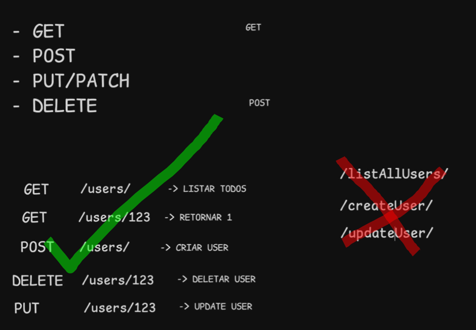
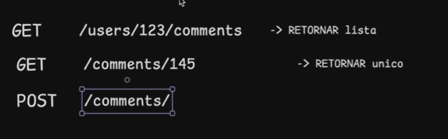
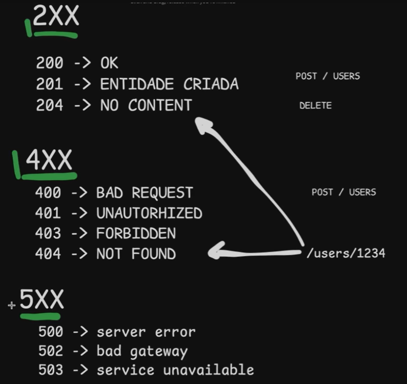
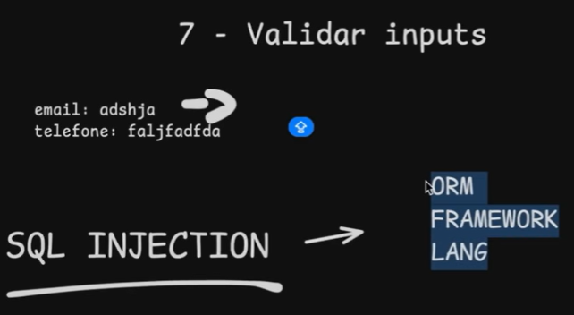
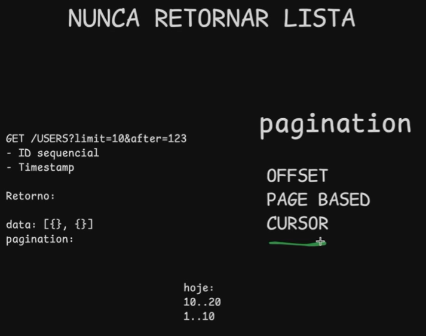
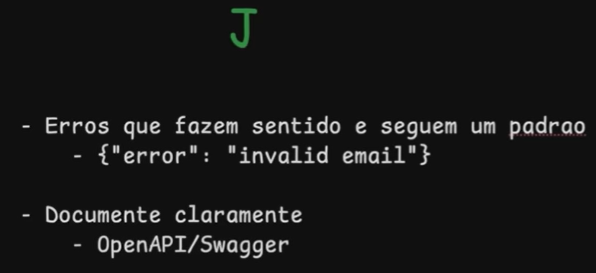

# 5 dicas para fazer APIs melhores.

## Regras de ouro

> - REST
> - Padrões são melhores do que o que você vai inventar
> - **Principle of least surprise**

## 1. Padrões

Evitar redundancias

## 2. Retornar status apropriados

## 3. Validar inputs

## 4. Retornos e paginação

Offset poem parametros no chamado de limit e offset
Cursor poem um id ou data e pega os itens depois desse record

Adicione retornos claros para erros
